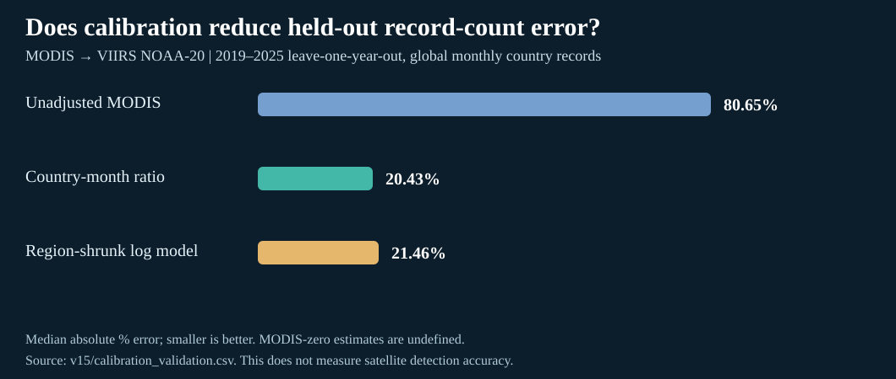

# MODVIIR — One Fire Calendar from Two NASA Satellites

Formerly FireLens. Repository URL kept as firelens-v9 so the live app link stays stable.

https://u98xspjn5tsz9kysvyppmw.streamlit.app/

**MODVIIR helps researchers inspect where satellite hotspot records agree, where documented interruptions affect interpretation, and whether historical count conversions withstand held-out testing.**

**Source code:** [GitHub repository](./) · **Live app:** A verified Streamlit deployment URL has **not yet been supplied**; do not substitute the repository URL for a tested live application.



**Data limits:** Country-scale historical estimates are statistical conversions of **type-0 hotspot record counts**, not burned area or distinct wildfire events. NASA MODIS begins in November 2000; NOAA-20 VIIRS begins in April 2018. Reported positive records cannot establish satellite observation opportunity or independently verified non-fire cells. The California ConvLSTM test was inspected during development and is not an operational wildfire warning.

---

# MODVIIR — Evidence Before Assumptions
**Global Atlas → Country Comparison → California Fire Laboratory.** MODVIIR V11 now combines the preserved V10 Amazon/California research with 34 NASA worldwide annual country archives (MODIS 2000–2025, VIIRS NOAA-20 2018–2025). The worldwide analysis uses **252,915,305 NASA type-0 presumed vegetation-fire positive records** summarized into 7,033 country-year entries, not unique wildfire counts or sensor-calibrated fire rates.

Navigate using the **three primary workspaces in the Streamlit sidebar**. The California workspace retains Sensor Harmonization, AI Forecasting & Validation, the Amazon field study and source methods as secondary tools. Details, exact source hashes and reproducible methods: [V11 research documentation](v11/README.md).

The original V8 modules and frozen California ConvLSTM are unchanged. **The California model is not validated for global use.** This is not a real-time fire-warning system.

---


**Now includes a verified Amazon regional research panel.** The two user-provided NASA archive ZIPs (MODIS `DL_FIRE_M-C61_850616.zip`; VIIRS S-NPP `DL_FIRE_SV-C2_850617.zip`) contain **4,404,388** raw thermal-anomaly records for the Amazon study rectangle `[-74, -15, -48, 2]` spanning 2022–2025. After filtering to NASA Type-0 presumed vegetation-fire observations, **4,386,124** records contribute **917,907 union 10-km cell-days**. These are not distinct wildfires, burned area, or ground-truth labels.

The lightweight regional summaries, 1° spatial raster and source checksums are in [`v10/processed/amazon/`](v10/processed/amazon); preprocessing, methods and tests are in [`v10/`](v10/). Open **04 AMAZON 2022–2025** in the Streamlit app. The California ConvLSTM is **not** trained or validated on Amazon data.

**Scientific caution:** Satellite archives may omit detections because of acquisition conditions, sensor disruptions, clouds, or other factors. The screening tool uses positive records and retrospective reference years; it is not an operational fire-warning service. Same-day/same-cell sensor co-occurrence is not acquisition-time matching or sensor accuracy.

## Preserved California V9.1 pilot

The sections and methodology documented below are retained.

# MODVIIR V9 — Evidence Before Assumptions

NASA Space Apps Challenge 2026 • Harmonization of MODIS and VIIRS Hot Spots • California pilot

## Start the V9 app

```bash
python -m pip install -r requirements.txt
streamlit run app.py
```

**No upload is needed for the bundled demo.** The new V9 entry point uses verified real July 2024 NASA FIRMS observations and a frozen, historically evaluated 2025 ConvLSTM prediction archive. This is a retrospective prototype, **not** a live operational fire-warning service.

The new V9 includes:

1. **Explore history** — 2022–2025 daily positive union grid-cell counts as a calendar, with any-record availability warnings and July 2024 user-selectable bounding rectangles.
2. **Investigate evidence** — verified Park Fire retrospective final-footprint grouped comparison, time matching, documented 2024 VIIRS S-NPP disruption context, and exportable audit.
3. **Replay the model** — frozen 2025 ConvLSTM V2 proxy scores, recorded positives, overlap/error grid, and a locked validation-selected threshold.
4. **Methods & sources** — direct sources, limitations, provenance, and a numerical audit JSON.

**Preserved:** `legacy_v8/` is an unchanged copy of the archived original source bundle. To use the legacy application instead, run `streamlit run legacy_v8/app.py` (its original V8 synthetic demo starts enabled; upload real data after disabling it). We deliberately do not alter any original V8 Python module.

## What the numbers mean

### July 2024 V8 case study

Input files (unchanged):

- MODIS: `fire_archive_M-C61_850130.csv` — 4,851 raw California records.
- VIIRS S-NPP: `fire_archive_SV-C2_850131.csv` — 7,770 raw California records.

July 15–31, 2024; previously exported **retrospective final** Park Fire polygon; 5 km projected equal-area bins; same UTC day and D/N phase; 3 h acquisition-time tolerance.

| Metric | Real, reproducible count |
|---|---:|
| Raw detections inside final footprint | 3,092 |
| At least one positive hotspot record in a cell/date/phase group | 316 |
| Both sensors recorded a hotspot in that group | 54 |
| Both positive, with a pair acquired within 3 hours | 45 |
| MODIS-only positive groups | 234 |
| VIIRS-only positive groups | 28 |
| Both-positive but outside selected time tolerance | 9 |

The 45/54 = 83.33% rate is conditional on both sensors having reported a hotspot in the same group. The 45/316 = 14.24% share uses **all positive** groups. **Neither is satellite accuracy.** No-hotspot cells are not verified negatives. The polygon is an eventual historical footprint, not July daily growth.

### 2022–2025 experimental forecast

Original NASA input archive sources according to `data/predict/source_inventory.csv`:

- MODIS: `fire_archive_M-C61_850338.csv` within archive `DL_FIRE_M-C61_850338.zip` — 33,738 records.
- VIIRS S-NPP: `fire_archive_SV-C2_850339.csv` within archive `DL_FIRE_SV-C2_850339.zip` — 139,733 records.

The original four-year raw archives **are not included** in this compact V9 package. The `reproduction/` builder and trainer are provided for rebuilding from user-downloaded NASA archives.

The 7-day-to-next-day model uses 99×103 10 km EPSG:6933 grid cells and 4 channels. Time split (target dates): training 2022-01-08–2024-05-26 (870), validation 2024-05-27–2025-03-14 (292), exploratory test 2025-03-15–2025-12-31 (292). ConvLSTM hidden width 8, class weight 10, 20 epochs, validation-selected fixed threshold 0.675.

| Metric | Validation ConvLSTM | Validation persistence | Exploratory 2025 ConvLSTM | 2025 persistence |
|---|---:|---:|---:|---:|
| F1 | 0.430096 | 0.395512 | 0.421170 | 0.381814 |
| IoU | 0.273963 | 0.246503 | 0.266761 | 0.235952 |
| False positives | 4,655 | 5,827 | 4,363 | 5,603 |

Relative test F1 uplift 10.3%; test false-positive count reduction 22.1%. These count **positive-record proxy overlaps**. The 2025 test window was inspected during V1 development, so it is **not fully untouched confirmation**. We do not claim ignition prediction, independently verified absence of fire, spread forecasting, calibrated wildfire probabilities, sensor accuracy, or operational readiness.

## Integrity and smoke tests

```bash
python tests/test_integrity.py
python tests/smoke_without_streamlit.py
```

The numerical test reconstructs counts directly from the frozen prediction grids and original study tables; the offline UI stub test exercises the chart-generation/control logic without requiring an installed Streamlit runtime. **A browser-deployment smoke test remains necessary** before submission. In the development environment, installing Streamlit was blocked by unavailable package-network access, so no live browser deployment has been claimed.

## Rebuilding V2 with original NASA archives

```bash
python reproduction/build_dataset.py --input-root path/to/archive_folder --out data_new --start 2022-01-01 --end 2025-12-31 --km 10 --history 7
python reproduction/train_predict_v2.py --data data_new/MODVIIR_sequences.npz --manifest data_new/sequence_manifest.csv --out training_new --epochs 20 --batch-size 8 --hidden 8 --lr 0.001 --seed 42
```

**Prerequisites:** Both MODIS and VIIRS California archive exports, available from NASA FIRMS. Reproduction may vary by PyTorch/CUDA version and data archive changes. The historic model weights and resulting frozen outputs provided in V9 are the measured artifacts.

## Submission materials

- `submission/` — final 7-slide demo (MODVIIR_slides.pdf) and links.

## Official source links

- [2026 NASA challenge](https://www.spaceappschallenge.org/2026/challenges/harmonization-of-modis-and-viirs-hot-spots/)
- [NASA FIRMS archive downloads](https://firms.modaps.eosdis.nasa.gov/download/)
- [NASA FIRMS missing-data list](https://firms.modaps.eosdis.nasa.gov/api/missing_data/)
- [NASA MODAPS Suomi NPP disruption archive](https://modaps.modaps.eosdis.nasa.gov/services/production/outages_suomi_npp.html)
- [CAL FIRE historic fire perimeters](https://www.fire.ca.gov/what-we-do/fire-resource-assessment-program/fire-perimeters)

## Future work

1. Establish actual MODIS/VIIRS pixel-level satellite observation opportunities and cloud/scan masking.
2. Calibrate sensor-to-sensor detection sensitivity and physically meaningful measures, rather than equating raw positives.
3. Evaluate forecasting against new **independent** future periods and independently attributed fire events, other regions, and per-event and seasonal outcomes.
4. Broaden global geographical coverage only after a reproducible source-and-quality pipeline exists.

## AI disclosure

ChatGPT (OpenAI) wrote and debugged most code under the author's direction. Claude (Anthropic) reviewed the project, re-ran tests, suggested validation methods, and helped draft text and the logo graphic (watermarked 'AI-generated graphic'). All numerical results come from code run on NASA FIRMS data.
